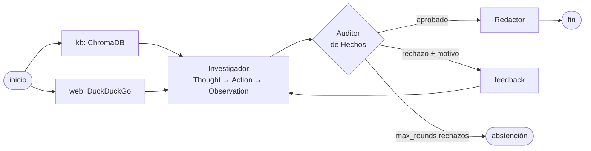

# Sistema Multi-Agente ReAct

Tres agentes coordinados por un grafo cíclico de **LangGraph** responden preguntas, resuelven problemas matemáticos y escriben código usando herramientas reales. El orquestador es **Mistral-7B-Instruct-v0.3 cuantizado a 4 bits**, ejecutado en una GPU Tesla T4 de Colab. Un Auditor de Hechos puede rechazar la respuesta del Investigador y devolverle el flujo con el motivo del rechazo.

| | |
|---|---|
| **Agentes** | Investigador (ReAct), Auditor de Hechos (guardrail), Redactor |
| **Herramientas** | ChromaDB sobre WikiQA, DuckDuckGo, calculadora segura y ejecución aislada de Python |
| **Datasets** | WikiQA, GSM8K y MBPP (Hugging Face) |
| **Evaluación** | 50 consultas, *Faithfulness* y *Answer Relevance* con LLM-as-a-Judge, más verificación objetiva |
| **Entregables** | [`notebooks/proyecto2_output.ipynb`](notebooks/proyecto2_output.ipynb) (ejecutado en la T4) e [`informe/main.pdf`](informe/main.pdf) |

## Contenido

- [Arquitectura](#arquitectura)
- [Resultados](#resultados)
- [Cómo ejecutarlo](#cómo-ejecutarlo)
- [Estructura del repositorio](#estructura-del-repositorio)
- [Decisiones de diseño](#decisiones-de-diseño)
- [Limitaciones](#limitaciones)
- [Referencias](#referencias)

## Arquitectura



1. **Recuperación en paralelo.** `kb` y `web` se consultan a la vez (fan-out de LangGraph) y el Investigador arranca con esa evidencia. Si una rama falla, la otra sigue.
2. **Investigador.** Ejecuta un bucle ReAct de hasta 6 pasos. En cada paso el LLM escribe un `Thought` y una `Action`, y solo el sistema escribe la `Observation`.
3. **Auditor de Hechos.** Primero aplica reglas deterministas: rechaza si no hay respuesta o no hay evidencia, y en código **ejecuta** la respuesta con los `assert` del enunciado. Después le pide al LLM que verifique si la evidencia respalda la respuesta.
4. **Retroalimentación.** Si rechaza, el motivo y la respuesta rechazada vuelven al Investigador. Tras `max_rounds = 3` rechazos el sistema se abstiene en vez de entregar una respuesta sin respaldo.
5. **Redactor.** Reformula la respuesta aprobada sin agregar datos. El código ya verificado lo entrega sin cambios.

Hay un grafo por tipo de tarea, cada uno con sus herramientas:

| Tarea | Dataset | Herramientas | Cómo audita |
|---|---|---|---|
| `qa` | WikiQA | `kb[...]`, `web[...]` | El LLM compara la respuesta con la evidencia |
| `math` | GSM8K | `calc[...]` | El LLM revisa que el número responda lo que se pregunta |
| `code` | MBPP | `python[...]` | Ejecuta el código con sus pruebas, sin preguntarle al LLM |

## Resultados

50 consultas (20 de WikiQA, 15 de GSM8K y 15 de MBPP). Los dos métodos se corrieron sobre las mismas consultas y con el mismo juez, en una T4 con Mistral-7B de 4 bits.

**Métricas del juez (RAGAS, LLM-as-a-Judge), sobre las 50 consultas:**

| método | respondidas | faithfulness | faithfulness (respondidas) | answer relevance | s/consulta |
|---|---|---|---|---|---|
| **multi-agente** | 0.84 | 0.580 | **0.691** | 0.792 | 88.9 |
| Naive RAG | 1.00 | **0.663** | 0.663 | **0.911** | 26.0 |

**Verificación objetiva, sobre las 30 consultas de GSM8K y MBPP:**

| método | exactitud | exactitud al responder | respuestas incorrectas entregadas ↓ |
|---|---|---|---|
| **multi-agente** | **0.50** (15/30) | **0.68** (15/22) | **0.23** (7/30) |
| Naive RAG | 0.30 (9/30) | 0.30 (9/30) | 0.70 (21/30) |

Por dataset, la exactitud es 0.33 contra 0.20 en GSM8K y 0.67 contra 0.40 en MBPP. En MBPP el multi-agente no entregó **ningún** código incorrecto; el Naive RAG entregó 9. En WikiQA la fidelidad es 0.605 contra 0.649 y la relevancia 0.88 contra 0.89.

### Conclusiones

- **El multi-agente supera al Naive RAG donde la respuesta se puede verificar.** Tiene 20 puntos más de exactitud y entrega tres veces menos respuestas incorrectas (7 contra 21). Acierta 8 consultas que el Naive RAG falla, y el Naive RAG acierta 2 que el multi-agente no.
- **El guardrail cambia errores por abstenciones.** En 7 de las 8 abstenciones del multi-agente, el Naive RAG entregó una respuesta incorrecta. Es lo que pide el enunciado: no propagar alucinaciones.
- **El Auditor es tan bueno como su verificación.** En MBPP ejecuta el código y nunca aprobó un error, y en 2 consultas el error devuelto permitió corregir el código. En GSM8K depende del mismo 7B y aprobó 6 errores de razonamiento.
- **Las métricas del juez favorecen al Naive RAG por dos razones.** Las abstenciones puntúan 0, y el juez de 7B casi no distingue una respuesta correcta de una incorrecta: les da *Answer Relevance* de 1.00 y 0.93 y *Faithfulness* de 0.74 y 0.69. Por eso la verificación objetiva es la evidencia más fuerte.
- **Cautela estadística.** Con 10 pares discordantes, la ventaja en exactitud tiene p = 0.109 (McNemar exacto). Es consistente, pero no significativa al 5 % con 30 consultas.

El detalle consulta por consulta está en [`docs/analisis_errores.md`](docs/analisis_errores.md). Los datos están en [`results/`](results/): `tabla_comparativa.csv` (la tabla) y `evaluacion.jsonl` (un registro por consulta y método). Si cambian las métricas, `python scripts/resumir_resultados.py` regenera la tabla sin volver a correr los modelos.

## Cómo ejecutarlo

### En Colab desde el navegador (recomendado)

1. Abrir [`notebooks/proyecto2.ipynb`](notebooks/proyecto2.ipynb) en Colab con GPU T4.
2. Aceptar los términos de [Mistral-7B-Instruct-v0.3](https://huggingface.co/mistralai/Mistral-7B-Instruct-v0.3) en Hugging Face (es un modelo restringido) y guardar el token como `HF_TOKEN` en *Secrets*.
3. Ejecutar todo. La evaluación completa toma unos 96 minutos.

Cada resultado se guarda en `results/evaluacion.jsonl` apenas se calcula. Si la sesión se corta, al volver a ejecutar la celda se reanuda donde quedó.

### En Colab desde la terminal

Con la [Colab CLI](https://github.com/googlecolab/google-colab-cli). El primer comando abre el login OAuth en el navegador.

```bash
HF_TOKEN=hf_... scripts/colab_run.sh              # corrida completa
FULL_RUN=0 HF_TOKEN=hf_... scripts/colab_run.sh   # solo la prueba de tiempo
```

El script crea una sesión con T4, sube `src/`, ejecuta el notebook, baja los resultados a `results/` y cierra la sesión. La salida queda en `notebooks/proyecto2_output.ipynb`.

### Pruebas locales (sin GPU ni red)

```bash
uv venv --python 3.12 .venv
uv pip install --python .venv/bin/python langgraph datasets pytest
.venv/bin/python -m pytest -q
```

Las pruebas usan adaptadores falsos (`ScriptedLLM`, `StaticSearch`, `InMemoryKB`). Para correr el notebook sin GPU, `BACKEND = "nvidia"` usa una API remota (`NVIDIA_API_KEY` en `.env`, ver `.env.example`).

## Estructura del repositorio

Arquitectura hexagonal: el núcleo (`domain` y `application`) solo importa puertos. Cambiar Mistral por otro LLM, o ChromaDB por FAISS, es reemplazar un adaptador.

```text
src/
├── domain/        entidades puras: Evidence, Report, BenchmarkItem, AuditVerdict, ExecutionResult, EvalRecord
├── ports/         contratos (Protocol): LLMPort, WebSearchPort, KnowledgeBasePort, DatasetPort,
│                  CodeRunnerPort, ResultStorePort
├── application/   agentes: Investigator, Auditor, Redactor, build_flow (grafo), naive_rag (baseline)
│                  herramientas: calculator, answer_checks
│                  evaluación: Judge, Evaluator, eval_set, eval_summary
│                  prompts.py y formatting.py: plantillas y formato, sin lógica
└── adapters/      reales: MistralLocalLLM, NvidiaLLM, DuckDuckGoSearch, ChromaKB, HFDatasetAdapter,
                   SubprocessCodeRunner, JsonlResultStore
                   falsos (pruebas): ScriptedLLM, StaticSearch, InMemoryKB
docs/              analisis_errores.md: revisión consulta por consulta de la corrida
informe/           informe final en LaTeX (main.tex, secciones/) y su PDF
notebooks/         proyecto2.ipynb (para ejecutar) y proyecto2_output.ipynb (ejecutado en la T4)
results/           resultados de la corrida de 50 consultas
scripts/           colab_run.sh, resumir_resultados.py (regenera la tabla), analisis_errores.py
tests/             pruebas offline
```

## Decisiones de diseño

### Agentes y herramientas

- **Un grafo por tarea.** `build_flow(..., task="qa" | "math" | "code")` elige las herramientas, el ejemplo resuelto del prompt ReAct y las reglas del Auditor y del Redactor. GSM8K y MBPP no tienen acceso a la web: no aporta y podría devolver la solución publicada del propio benchmark.
- **Concurrencia.** Con `prefetch=True`, `kb` y `web` se consultan a la vez y un reductor de LangGraph une la evidencia. `tests/test_concurrency.py` lo comprueba con una barrera.
- **Código entregado = código ejecutado.** Si el Investigador dice que su código pasó las pruebas pero no lo copia en `Final`, se entrega el código que realmente ejecutó. El Redactor no reescribe código ya verificado.
- **Redactor sin relleno.** Solo reformula la respuesta verificada, sin agregar datos ni listas de fuentes. En la prueba con la T4 inventaba explicaciones que bajaban la fidelidad.
- **Idioma.** El Investigador busca en el idioma de la pregunta. La base y la web están en inglés, y las búsquedas en español recuperaban fragmentos irrelevantes.

### Límites del 7B, medidos en la T4

- Repite la misma `Action` en bucle. Por eso hay una regla anti-repetición, un ejemplo resuelto en el prompt y un último paso que exige `Final`.
- A veces razona mal aunque `calc` le dé el resultado correcto. Ningún guardrail determinista arregla un error de razonamiento.
- Como juez, casi siempre da 10/10 en *Answer Relevance*.

### Evaluación

- ***Faithfulness* y *Answer Relevance*** siguen las definiciones de RAGAS, implementadas como LLM-as-a-Judge, sin la librería `ragas`. GSM8K (número final) y MBPP (`test_list`) además se verifican de forma objetiva.
- **Abstenciones.** Puntúan 0. `faithfulness_respondidas` promedia solo las respuestas entregadas.
- **Base de conocimiento.** Se indexan todas las frases candidatas de WikiQA, también las incorrectas, para que el Naive RAG no parta con ventaja (126 preguntas y 1119 frases).
- **Juez.** Por defecto es el mismo Mistral que orquesta (`JUDGE_BACKEND = "same"`). Se puede usar un juez remoto con `JUDGE_BACKEND = "nvidia"`. Los formatos inválidos del juez se cuentan en `juez_fallido`.
- **MBPP.** Los dos métodos ven los `assert` en la pregunta, como en Austin et al. (2021), pero solo el multi-agente puede ejecutarlos. Su exactitud mide si sabe verificar y corregir su código, no si generaliza a pruebas ocultas.

## Limitaciones

- Una sola corrida de 50 consultas. La ventaja en exactitud no es significativa al 5 % (p = 0.109).
- El juez es un 7B y es el mismo modelo que responde, así que es ruidoso y puede favorecer sus propias respuestas. Casi no distingue respuestas correctas de incorrectas.
- Los registros no guardan el texto de la evidencia ni el motivo de cada rechazo, así que no se puede volver a juzgar sin repetir la generación.
- El verificador de GSM8K tiene un falso negativo conocido (GSM8K 5). La tabla usa la salida automática sin corregirla.
- El multi-agente es unas 3,4 veces más lento que el Naive RAG.
- `SubprocessCodeRunner` limita tiempo, CPU y memoria, pero no bloquea la red ni los archivos. Es aceptable porque la VM de Colab es desechable. En macOS el límite de memoria no se aplica.

## Referencias

- Yao, S., et al. (2023). *ReAct: Synergizing Reasoning and Acting in Language Models*. ICLR 2023.
- Yang, Y., et al. (2015). *WikiQA: A Challenge Dataset for Open-Domain Question Answering*. EMNLP 2015.
- Cobbe, K., et al. (2021). *Training Verifiers to Solve Math Word Problems*. arXiv:2110.14168.
- Austin, J., et al. (2021). *Program Synthesis with Large Language Models*. arXiv:2108.07732.
- Es, S., et al. (2024). *RAGAS: Automated Evaluation of Retrieval Augmented Generation*. EACL 2024.
